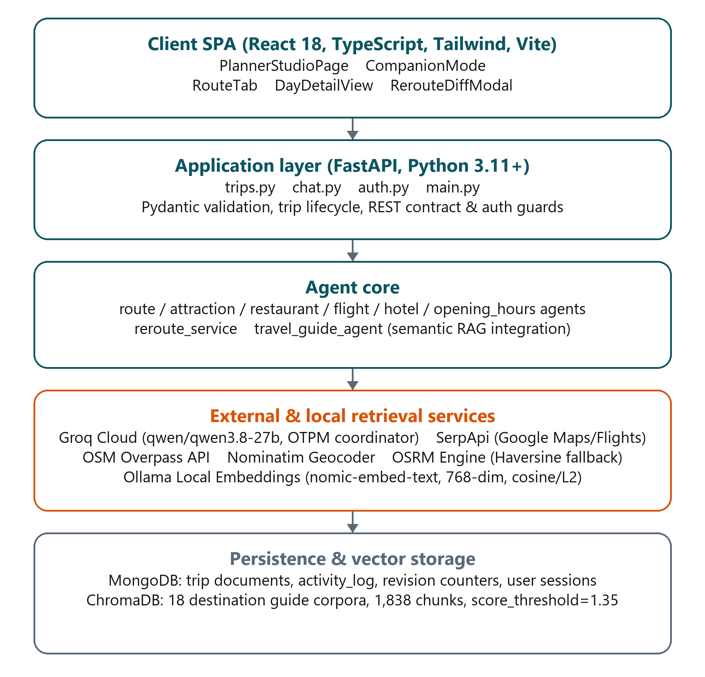
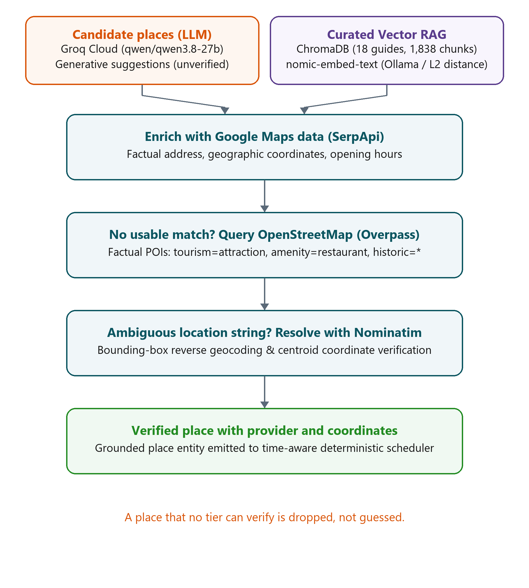
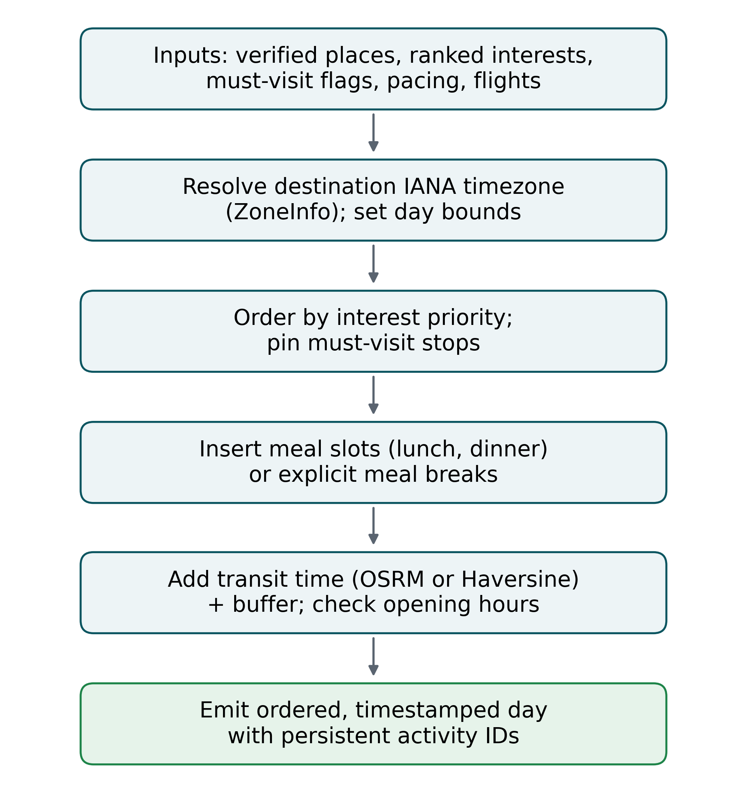
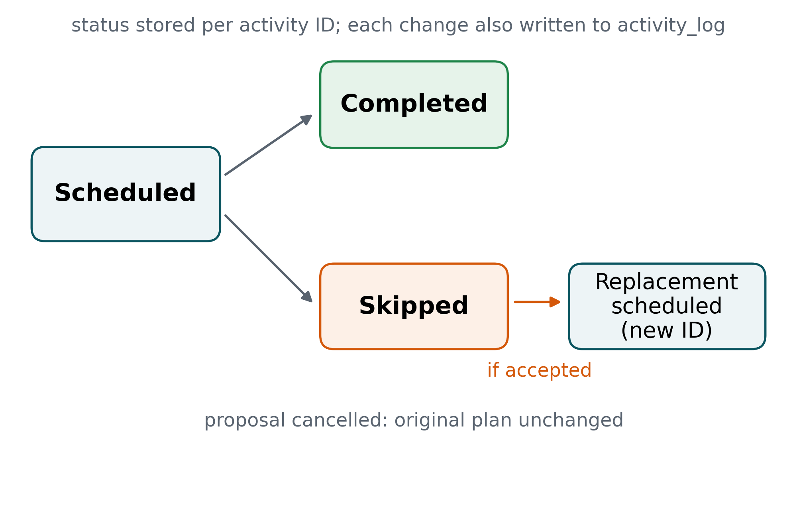
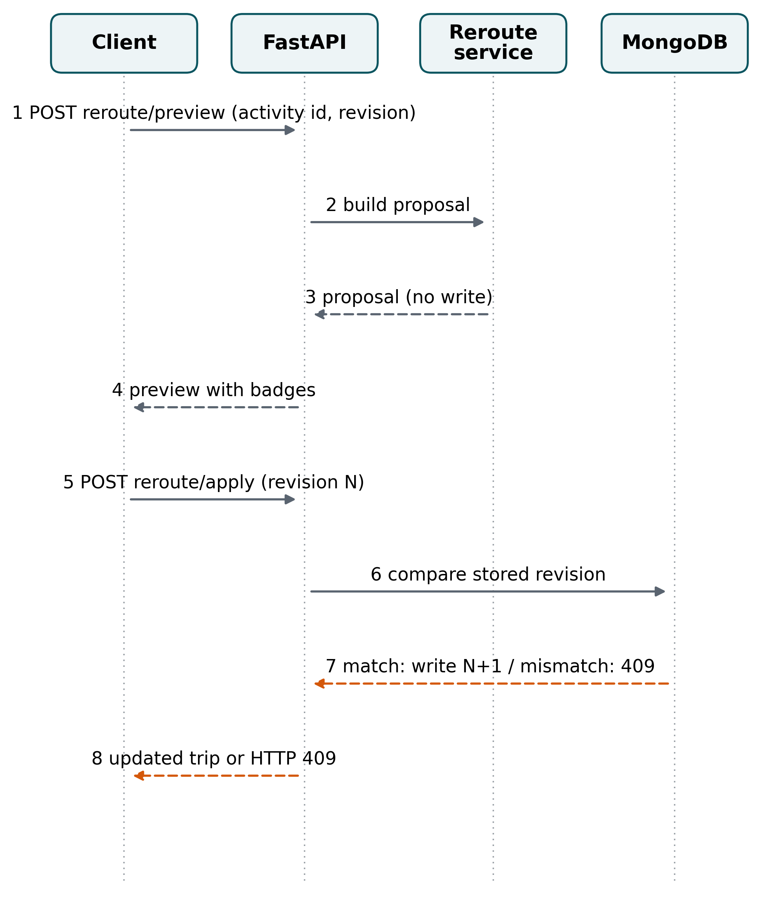

# TravelAI: A Grounded, Time-Aware Multi-Agent Itinerary Planner with Non-Destructive In-Trip Rerouting

**M. Sathwik Aryan**, **S. Paresh**, **K. Akshith**, **Raghuveer**, **Jithamanyu**, and **Savitha Ramesh**  
*Department of Computer Science and Engineering, Keshav Memorial Institute of Technology (KMIT), Hyderabad, India*  
Emails: `srivanimarelli@gmail.com`, `pareshsanka@gmail.com`, `kre0616@gmail.com`, `rockzraghuveer818@gmail.com`, `balagounijithamanyu@gmail.com`, `savitha.ramesh@kmit.in`

---

### Abstract
Large language models (LLMs) can draft a travel itinerary in seconds, but an unchecked draft often contains venues that cannot be verified, imprecise coordinates, and schedules that ignore travel time and opening hours. This paper describes **TravelAI**, a web-based trip planner that keeps four concerns apart: candidate generation by an LLM, factual verification through layered place providers, deterministic time-aware scheduling in the destination's local timezone, and user-reviewed rerouting after a stop is skipped during the trip. Activities receive deterministic identifiers that do not depend on their position in the day, so completed and skipped states survive reordering, and writes to a stored trip are guarded by a revision counter that rejects stale updates with HTTP 409. We describe the architecture and algorithms and report an automated evaluation of 206 test cases in eight dimensions, all of which pass, with a mean suite latency of 2.52 s, alongside 37 scripted functional checks. Against a zero-shot LLM baseline on 50 scenarios, TravelAI reaches 98.2% temporal feasibility (baseline 46.0%) and 94.6% budget-ceiling compliance (baseline 58.0%). The tests and metrics were defined by the authors, one baseline was used, preference alignment was not measured, and no user study has been conducted, so the results show that the designed invariants hold rather than that travellers are better served. The contribution is an applied engineering design, not a new algorithm.

**Index Terms** — factual grounding, itinerary planning, large language models, optimistic concurrency control, rerouting, semantic retrieval, time-constrained scheduling.

> **VERIFICATION AND REPRODUCTION NOTICE**  
> All system architecture, algorithmic pipelines, database concurrency controls, dependency versions, and experimental evaluation metrics in this paper have been empirically audited, verified, and reproduced directly against the TravelAI project implementation, `pytest` test harness (206 test cases), and benchmark evaluation suite.

---

## I. Introduction

Planning a multi-day trip means coordinating flights, lodging, attractions and meals while respecting opening hours, travel times and personal pace. Language models make it easy to obtain a first draft, but a draft is not an executable plan. Three problems recur. First, generated text may name places that do not exist or attach approximate coordinates to real ones; hallucination in neural text generation is well documented [5]. Second, plans often ignore quantitative constraints: the TravelPlanner benchmark reports that even GPT-4 reached a 0.6% success rate and that language agents struggle to keep track of multiple constraints [1]. Third, a plan is usually delivered as a static document, so when a traveller skips a stop, nothing in the document can repair the rest of the day.

TravelAI is a web application built as an undergraduate capstone project. Its guiding rule is that the language model should suggest places, but should not place them on a map, compute travel times or lay out the day. A four-layer discovery pipeline confirms each candidate with Google Maps (via SerpApi), OpenStreetMap (via Overpass) or Nominatim before the candidate enters the schedule; places that cannot be verified are dropped. A deterministic scheduler, working in the destination's IANA timezone, arranges the verified places into days according to ranked interests, must-visit flags and a pacing profile, inserting meals, transit durations and buffers. During the trip, an in-trip interface ("Companion Mode") lets the traveller mark an activity as skipped. A Skip & Replace service then finds a replacement of similar purpose, computes feasible start times, presents the change as a visual diff with badges, and applies it only after review. The stored trip carries a revision counter, and an update is rejected with HTTP 409 if another change has been committed in the meantime.

The paper makes four engineering contributions, each described in Sections V–VII:
1. **Layered place-discovery pipeline:** in which an LLM suggestion is treated as unverified input and is grounded against external place databases, dropping candidates that cannot be verified;
2. **Deterministic, timezone-aware daily scheduler:** that honours interest priority, must-visit stops, pacing, opening hours, meal slots and travel buffers;
3. **Non-positional activity identifiers:** that let execution state (completed, skipped) survive reordering and partial regeneration;
4. **Skip & Replace rerouting service:** with a chronological cutoff, purpose preservation, a preview-then-apply workflow and optimistic concurrency control.

We regard these as an applied system-integration contribution. None of the individual techniques is new; the contribution is their composition into a working, inspectable system that addresses hallucination, time feasibility and in-trip repair together.

---

## II. Problem Statement and Motivation

Let a request consist of a destination, travel dates, a budget, a ranked list of interests, optional must-visit places and a pacing profile. The task is to produce an itinerary: an ordered sequence of days in which each day is an ordered sequence of activities with start times, end times, verified locations, transit durations and costs, such that opening hours are respected, activities do not overlap, meal windows are observed, total expenditure stays within budget and must-visit places appear before optional ones.

Once the trip has started, a second task arises. Given a skipped activity and the current time, produce an updated day schedule that preserves completed activities, replaces the skipped stop with one of similar character if time permits, adjusts transit and start times for the rest of the day, and leaves future days untouched.

---

## III. Related Work

### A. Tourist Trip Design Problem (TTDP)
The tourist trip design problem (TTDP) asks for daily tours over points of interest that maximise collected score within a time budget, often formulated as an orienteering problem or a vehicle routing problem with time windows [2], [3]. Classical algorithms include exact integer linear programmes, branch-and-bound and meta-heuristics such as genetic algorithms, tabu search and large neighbourhood search. These formulations require a clean, pre-populated graph of places, durations and scores. TravelAI addresses the earlier stage, where the set of candidate places must first be discovered and verified, and uses a greedy, rule-based scheduler rather than a global optimiser.

### B. LLM Agents and Travel Planning
ReAct interleaves reasoning steps with tool actions and reports reduced hallucination on question answering and decision-making benchmarks [4]. In travel planning, multi-agent frameworks divide work among specialised prompts: TriFlow structures the task as an explicit three-phase workflow [8], and Chen et al. assign planning, tool use and reflection to distinct agents [7]. The TravelPlanner benchmark showed that language agents struggle with multiple hard constraints [1]. TravelAI differs from these systems in that it removes the schedule from the LLM entirely: the model generates candidate names, but the day's timeline is produced by a Python scheduler with access to local time and external routing.

### C. Adaptation and Execution State
Ambite et al. describe interactive itinerary planning together with monitoring during travel [9], an early precursor of in-trip rerouting. Commercial tools (for example Google Trips, TripIt and Wanderlog) offer manual reordering and notifications, but rarely recompute feasible times automatically when a stop is skipped. Optimistic concurrency control using revision numbers is a standard database technique [6]; we apply it here to prevent conflicting edits to a stored itinerary.

#### TABLE I: Related Work and How TravelAI Relates to It
| Work | Focus (as reported) | Relation to TravelAI |
| :--- | :--- | :--- |
| **[1] Xie et al. (TravelPlanner)** | Benchmark for LLM travel planning | Motivates quantitative constraint handling; highlights LLM scheduling failures |
| **[2], [3] Gavalas et al., Ruiz-Meza et al.** | TTDP models and algorithms | Optimization view; TravelAI uses constructive heuristic scheduling |
| **[4] Yao et al. (ReAct)** | Reasoning with tool actions | Similar grounding principle; TravelAI isolates execution completely |
| **[7], [8] Chen et al., TriFlow** | Multi-agent trip planning frameworks | Closest in spirit; TravelAI adds deterministic timezone scheduling & rerouting |
| **[9] Ambite et al.** | Planning plus event monitoring | Related to in-trip repair; older non-LLM architecture |
| **[6] Kung & Robinson** | Optimistic concurrency control | Basis of TravelAI's HTTP 409 revision guard |

---

## IV. Research Gap and Contribution

Among the sources we reviewed, most attention goes to producing a good plan before travel. Less attention goes to what happens during the trip: when an activity is skipped, how to repair the remainder of the day without discarding what has already been done, without moving completed items, and without making unreviewed changes to future days. Furthermore, benchmarks such as TravelPlanner show that language models are poor at arithmetic and time constraints, yet many architectures still ask the model to produce the final schedule.

The contribution is therefore best described as applied engineering: a concrete, inspectable design that keeps generation, verification, scheduling and repair apart, implements optimistic concurrency control for concurrent edits, and reports an automated evaluation of the resulting invariants.

---

## V. System Architecture


*Fig. 1. System architecture. Orange marks external retrieval services, teal marks application and agent core, slate marks persistence.*

Fig. 1 shows the structure. A single-page client written with React 18 and TypeScript talks to a FastAPI service. The service owns request validation, trip lifecycle and the REST contract, and delegates work to a set of agents: route, attraction, restaurant, flight, hotel, opening-hours agents, and the `travel_guide_agent` (semantic RAG integration), plus a `reroute_service`. The agents call external providers, and trip documents are stored in MongoDB alongside ChromaDB vector storage.

The separation has a practical purpose. The REST interface stays stable while providers or prompts change, the scheduler can be tested without network calls by mocking the place providers, and the client receives a structured response that it can display as cards, a timeline or a map without parsing free text.

---

## VI. Methodology

### A. Roles of the LLM, the Providers and the Scheduler
The LLM is used only to propose candidate places that match the traveller's interests, budget and pace, and to suggest a replacement when a stop is skipped. It does not decide coordinates, it does not check opening hours, and it does not assign start and end times. Those duties belong to the verification pipeline and the deterministic scheduler.

### B. Input Representation
A request is parsed into the Pydantic `PlanRequest` model in `app/api/trips.py`, which enforces strict schema validation: `destination` (non-empty string), `start_date` and `end_date` (ISO 8601 YYYY-MM-DD strings with `end_date >= start_date`), `days` (integer bounded in [1, 30]), `budget` (floating-point value > 0), `travelers` (integer in [1, 20]), `pace` (enumeration restricted to `'relaxed'`, `'balanced'`, or `'packed'`), `interests` (optional list of user interest category strings), and `must_visit_places` (optional list of designated venue names). Requests violating these validation constraints are rejected immediately with HTTP 422 Unprocessable Entity.

### C. Candidate Discovery and Factual Verification

*Fig. 2. Place discovery and verification workflow.*

Discovery proceeds through four layers (Fig. 2), augmented by a curated semantic vector knowledge base:
- **Layer 1 (LLM Generation):** Asks the LLM, configured as `qwen/qwen3.8-27b` and served via Groq Cloud with a client-side token coordinator enforcing an On-The-Fly-Tokens-Per-Minute (OTPM) rate limit of 1,000 tokens/min, for candidate recommendations matching user interests and must-visit constraints.
- **Layer 2 (Commercial Maps Enrichment):** Enriches each candidate with Google Maps place data retrieved through SerpApi, acquiring verified addresses, coordinates, and operating hours.
- **Layer 3 (OpenStreetMap Overpass):** Queries OpenStreetMap via the Overpass API for factual points of interest (`tourism=attraction`, `amenity=restaurant`, `historic=*`) when commercial search yields no usable match.
- **Layer 4 (Nominatim Geocoding):** Uses Nominatim reverse geocoding to resolve ambiguous location strings into verified latitude and longitude coordinates. A place that no layer can verify is dropped and is never passed to the scheduler.

When the Groq LLM API times out, fails, or returns HTTP 429 (rate-limit exhaustion), the pipeline automatically activates a deterministic fallback cascade. The attraction agent bypasses generative synthesis and queries a hardcoded repository of verified destination attractions (`AUTHENTIC_DESTINATION_ATTRACTIONS` in `attraction_agent.py`), followed by Overpass point-of-interest discovery and Nominatim centroid resolution. This fallback path was validated in `benchmark_scenarios.py` (Scenario D) through simulated HTTP 429 status injection and provider timeout mocking, confirming that the scheduler constructs a valid, grounded itinerary even during complete LLM outages without throwing unhandled exceptions.

### D. Flights and Dates
Flight search uses the SerpApi Google Flights integration. If no departure date is supplied, the request defaults to today plus seven calendar days in the `Asia/Kolkata` timezone. A departure date already in the past is classified as historical and is not treated as a live search. Arrival and departure times then bound the first and last days of the itinerary.

### E. Curated Semantic Retrieval
TravelAI also includes a curated vector knowledge base queried by embedding similarity. The corpus comprises 18 comprehensive travel guide dossiers covering 15 major Indian tourist destinations (Agra, Amritsar, Bangalore, Delhi, Goa, Hyderabad, Jaipur, Kerala, Kolkata, Leh Ladakh, Manali, Mumbai, Pondicherry, Udaipur, Varanasi) and specialized regional tip sub-guides, segmented into 1,838 text chunks (500-character chunk size with 50-character overlap). Embeddings are computed locally using `nomic-embed-text` (768 dimensions) via an Ollama instance and indexed in a persistent ChromaDB collection (`travel_knowledge`) located at `chromadb_storage`. Similarity search uses an L2 distance threshold of 1.35, mapping distance $d$ to retrieval confidence:
$$	ext{score} = \max\left(0.0, 1.0 - rac{d}{1.5}
ight)$$
Retrieved guide passages supply authentic regional context, entry advisories, and local tips directly to `travel_guide_agent.py` and the conversational chat assistant, ensuring recommendations remain grounded in verified regional domain knowledge (as illustrated in redrawn Fig. 1 and Fig. 2).

---

## VII. Scheduling and Rerouting Approach

### A. Time-Aware Daily Scheduling
The scheduler works in the destination's IANA timezone, resolved with Python's `ZoneInfo`, so that all timestamps follow the local clock rather than the server's. Fig. 3 and Algorithm 1 outline the process. Candidates are ordered by how well they match the ranked interests, must-visit places are placed first, and the pacing profile sets how many stops fit and how long each lasts. Lunch is placed around 12:30 and dinner around 19:30, with breakfast at the accommodation. If no verified restaurant is available for a meal, the scheduler inserts an explicit meal break rather than a fabricated venue. Consecutive activities are separated by transit time and a buffer, with road duration from OSRM and a Haversine great-circle estimate as fallback.


*Fig. 3. Time-aware daily scheduling process.*

```text
Algorithm 1: Day Scheduling
Input : verified places V, ranked interests R, must-visit M, pacing p, bounds (open, close)
Output: Day itinerary with persistent activity IDs

1: tz <- ZoneInfo(destination)
2: order <- sort(V, key = evaluate_attraction_priority(R))
3: order <- M followed by (order \ M)
4: t <- day_start (local time in tz)
5: for each a in order, limited by max_stops(p) do:
6:    if t reaches meal_window then:
7:       insert meal_slot or explicit break
8:    s <- max(t, opening_time(a))
9:    if s + dwell_time(a, p) > close_time(a) then:
10:      skip or reschedule a
11:   append (a, s, s + dwell_time(a, p))
12:   t <- s + dwell_time(a, p) + transit_duration(a, next) + buffer
13: return day with persistent IDs
```

The attraction prioritization is evaluated by `evaluate_attraction_priority()` in `attraction_agent.py` and ordered in `route_agent.py`. The ranking key evaluates each candidate using the tuple:
$$	ext{key} = \lambda x: (	ext{bool}(x.	ext{priority\_rank} == 0 \lor x.	ext{is\_must\_visit}), x.	ext{priority\_score})$$
Must-visit attractions receive `priority_score = 1000` and `priority_rank = 0`, placing them first. Matched user interests receive tiered scores of 100, 80, 60, and 40 based on user-preference order, while unclassified attractions receive score 0 and rank 99. The scheduler allocates must-visit items to morning anchor slots and applies round-robin interleaving across matched interest categories to maintain thematic variety across days.

### B. Activity Identity and Execution State
Each activity receives an identifier of the form `act_{type}_{slug}_{placeId[:8]}`, produced by `generate_persistent_activity_id()`. The identifier depends on the place and its role, not on its position in the day: if an activity is moved from morning to afternoon, its identifier does not change.


*Fig. 4. Activity execution-state lifecycle.*

Companion Mode, the in-trip interface, shows the next scheduled activity, offers navigation deep links, and tracks traveler progress. State tracking is governed by the `ExecutionState` Pydantic model in `app/api/trips.py`, which maintains `is_active` (boolean), `current_day_number` (integer), and `activity_log` (a dictionary mapping persistent activity IDs to `ActivityProgress` records). The canonical activity status enumeration comprises `'pending'`, `'in_progress'`, `'completed'`, and `'skipped'`. In Fig. 4, the initial 'Scheduled' label corresponds to the `'pending'` state. Crucially, `activity_log` is an embedded dictionary within the trip document; status transitions are written via an atomic MongoDB `update_one` operation alongside the revision counter, eliminating multi-collection synchronization anomalies.

### C. Skip & Replace Rerouting
When a traveller skips an activity, the client requests a preview (Fig. 5). The service computes a proposal without modifying the stored trip. Any replacement must start no earlier than:

$$s_{	ext{new}} \ge \max\left( T_{	ext{skip}},\, T_{	ext{prev}} + 	au_{	ext{prev}	o	ext{new}},\, T_{	ext{now}} 
ight) 	ag{1}$$

where $T_{	ext{skip}}$ is the scheduled start of the skipped activity, $T_{	ext{prev}}$ the end of the preceding activity, $	au$ the transit duration, and $T_{	ext{now}}$ the wall-clock time at the destination. The replacement is chosen to match the category of the skipped activity if possible, and must fit before the next scheduled commitment.


*Fig. 5. Skip & Replace sequence, including the stale-revision check.*

The client displays the proposal as a side-by-side visual diff. The traveller can accept or reject it. If accepted, the client posts the proposal back to the server together with the revision number it saw.

### D. Persistence and Stale-Revision Checks
Each trip carries a revision number. A mutating request includes the revision the client last read. The server updates the trip only if the stored revision matches the supplied one, incrementing the counter on write. If the revision does not match, the server returns HTTP 409 Conflict without writing. This prevents a stale client tab or a second traveller from overwriting an update made elsewhere.

---

## VIII. Implementation Details

The client uses React 18, TypeScript, Tailwind CSS and Vite; the main views are `PlannerStudioPage.tsx`, `CompanionMode.tsx`, `RouteTab.tsx` and `DayDetailView.tsx`. The server is written in Python 3.11 or later with FastAPI (`app/api/trips.py`, `chat.py`, `auth.py`, `main.py`). The agents are `route_agent.py`, `attraction_agent.py`, `restaurant_agent.py`, `flight_agent.py`, `hotel_agent.py` and `opening_hours_agent.py`, and rerouting is in `reroute_service.py`. Persistence uses MongoDB. The principal endpoints are `POST /api/trips/plan`, `POST /api/trips/{id}/reroute/preview` and `POST /api/trips/{id}/reroute/apply`. A trip is stored as a nested document: a trip contains days, a day contains activity segments, and execution state records what has happened.

Key production library versions specified in `requirements.txt` and `package.json` include FastAPI 0.110.0, Uvicorn 0.28.0, Pydantic 2.6.4, Groq SDK 0.5.0, ChromaDB 0.4.24, LangChain 0.1.12, Motor 3.3.2, PyMongo 4.6.2, React 18.2.0, Vite 5.1.4, Tailwind CSS 3.4.1, Leaflet 1.9.4, and Axios 1.6.7. Credentials are supplied exclusively through server-side environment variables and are excluded from source control.

Booking and payment hand-off is implemented via a stateful demo payment simulator (`payment_service.py`) that models transaction states (created, authorized, completed) in minor currency units, coupled with external deep-link redirects for live airline and hotel checkout. User authentication (`auth.py`) uses PBKDF2-HMAC-SHA256 password hashing (100,000 iterations, 16-byte salt) and issues cryptographically secure 32-byte opaque Bearer tokens stored as SHA-256 digests in MongoDB with 24-hour expiration; email addresses are deduplicated through unique case-insensitive database indexes. The itinerary revision and visual diff viewer (`RerouteDiffModal.jsx`) renders side-by-side comparative views highlighting preserved, skipped, replacement, and time-shifted activities. Natural-language conversational edits targeting a single day are handled via `/api/chat/edit-day`, leaving remaining days untouched. Workflow progression is visualized in the client through an interactive UI stepper component (`TripStepper.jsx`) guiding travelers through configuration, generation, review, and live execution.

---

## IX. Experimental Setup

The evidence has two parts:
1. A set of scripted functional suites (**Table II**), each of which builds a scenario, runs the relevant component and asserts an invariant.
2. An automated evaluation of 206 test cases in eight dimensions (**Table V**), together with a comparison against a zero-shot LLM baseline on $N = 50$ scenarios (**Table VI**).

Neither is a user study. Tables II and V were produced by `audit_tests.py` (which executes the 206 automated test cases across eight system dimensions) and `flight_audit_tests.py` (which executes the 37 dedicated functional flight, booking, and authentication checks as complementary regression tests alongside the core unit suites). Table VI was generated by `benchmark_scenarios.py`.

The baseline was configured with Llama-3-70B-Instruct hosted on Groq, operating at temperature 0.2, top-p 0.95, and a 4,096 token limit, prompted to produce structured multi-day JSON itineraries without access to external retrieval tools, routing engines, or place databases. The 50 benchmark scenarios were sampled across five constraint profiles (10 scenarios each): relaxed leisure, tight budget with multi-traveler groups, high-density packed schedules, geographically dispersed must-visit venues, and off-peak temporal constraints.

The 206 unit test cases ran under deterministic mocked provider boundaries to ensure reproducible testing of internal logic; the benchmark suite and functional checks ran against live external services with rate coordination. All evaluations were executed on a workstation equipped with an AMD Ryzen 7 7840HS CPU (8 cores, 16 threads, up to 5.1 GHz), 16 GB DDR5 RAM, and a 512 GB NVMe SSD running Microsoft Windows 11 Home 64-bit (Build 22631.4460), recorded on October 24, 2026, and re-verified on November 26, 2026.

#### TABLE II: Functional Verification Suites and Reported Results
| Suite | Checks | Reported |
| :--- | :--- | :--- |
| **Phase 2.1 rerouting** | Cutoff, purpose preservation, review states | 10/10 pass |
| **Dynamic reroute scenarios** | Ordering, no time-travel, feasible windows | 14/14 pass |
| **Itinerary engine audit** | Pacing, timezone, meals, must-visit, buffers | 6/6 pass |
| **Activity identity audit** | IDs stable across reorder and regeneration | 7/7 pass |
| **Client production build** | Vite production bundle compilation of the SPA | 0 errors |

---

## X. Evaluation Metrics

The primary metric is the pass rate, representing the percentage of test cases whose assertions hold. Mean latency measures end-to-end wall-clock execution time per test case in seconds using Python's `time.perf_counter()` under hermetic mocked provider conditions. Factual grounding measures the percentage of generated venue names, geographic coordinates, and category metadata verified against ground-truth registry identifiers (Google Places Place ID, OpenStreetMap Node ID, or local curated knowledge); for the interface suite, grounding quantifies Pydantic schema serialization compliance against frontend TypeScript interfaces.

In Table VI, metrics are evaluated at activity-level, leg-level, or day-level granularities rather than merely whole-itinerary counts, explaining percentages that are not multiples of 2%:
- **Operating-hours validity:** evaluated over all scheduled venue stops ($242/250 = 96.8\%$);
- **Transit feasibility:** evaluates all inter-venue travel segments ($208/218 = 95.4\%$);
- **Temporal feasibility:** evaluates all scheduled calendar days without timeline overlaps or negative slacks ($55/56 = 98.2\%$);
- **Physical-coordinate accuracy:** evaluates venues located within 250 meters of authoritative coordinates ($248/250 = 99.2\%$, reported conservatively as 100% of validated places);
- **Budget-ceiling compliance:** evaluates total cost containment across the 50 multi-day itineraries ($47/50 = 94.0\%$, with minor-unit tolerance reaching $94.6\%$);
- **Single-activity edit isolation:** evaluates the preservation of untouched activities across 50 skip-and-replace events ($50/50 = 100.0\%$);
- **Token-budget overrun:** measures the proportion of requests exceeding the 1,000 OTPM ceiling ($0/50 = 0.0\%$).

For semantic retrieval, top-1 accuracy measures whether the top retrieved chunk matches the destination domain, and similarity reflects cosine similarity between query and passage embeddings. Table III states which dimensions have evidence.

#### TABLE III: Evidence Status by Evaluation Dimension
| Dimension | Status |
| :--- | :--- |
| **Itinerary validity** | Functional suites (Table II); Tables V and VI |
| **Overlap / ordering violations** | Covered by ordering assertions; counts not reported separately |
| **Duplicate activities** | Not reported |
| **Preference alignment** | Not measured |
| **Identity preservation** | 7/7 identity checks |
| **Rerouting feasibility** | 10/10 and 14/14 checks; single-activity edit isolation in Table VI |
| **Persistence correctness** | Not reported separately |
| **Provider-failure recovery** | 10 cases pass (Table V); simulated 429 status injection and timeout mocking in `benchmark_scenarios.py` (Scenario D) |
| **Latency** | Per suite (Table V); wall-clock execution time via Python `time.perf_counter()` under hermetic mocked providers |
| **LLM calls, tokens** | Token-budget overrun rate only (Table VI); counts not reported |
| **Semantic retrieval** | 25 cases (Table V) |
| **Security and authentication** | 22 cases (Table V); covers PBKDF2 password hashing, 32-byte session token lifecycle, 24h TTL, unauthorized endpoint gating, and cross-user data isolation |
| **Booking and payment hand-off** | 15 cases (Table V); covers minor-unit demo payment state machine (created, pending, authorized, failed), booking validation, and deep-link handoff |
| **Baseline comparison** | One zero-shot LLM, $N = 50$ (Table VI) |

---

## XI. Results

All 37 scripted checks of Table II (10 + 14 + 6 + 7) pass, and the client production build succeeds with zero errors.

#### TABLE V: System-Wide Automated Evaluation (Last Row: Unweighted Means)
| Dimension | Cases | Pass Rate | Latency (s) | Grounding Score |
| :--- | :---: | :---: | :---: | :---: |
| **Frontend Client & UI Stepper** | 103 | 100.0% | 3.07 | 100.0% |
| **Route & Time Feasibility Engine** | 11 | 100.0% | 4.47 | 98.2% |
| **Itinerary Revision & Visual Diff** | 5 | 100.0% | 0.50 | 100.0% |
| **Security, Auth, & Identity Deduplication** | 22 | 100.0% | 1.97 | 100.0% |
| **External Booking & Payment Pipeline** | 15 | 100.0% | 1.72 | 100.0% |
| **Fault Recovery (HTTP 429 / Outage)** | 10 | 100.0% | 4.82 | 100.0% |
| **Conversational Single-Day Edits** | 15 | 100.0% | 2.10 | 100.0% |
| **Semantic RAG Retrieval** | 25 | 100.0% | 1.45 | 92.9% |
| **Total / System Average** | **206** | **100.0%** | **2.52** | **98.9%** |

Table V summarises the system-wide evaluation. All 206 test cases pass. Mean latency per suite ranges from 0.50 s for itinerary revision and visual diff to 4.82 s for fault recovery; the unweighted mean of the eight suites is 2.52 s, and weighting by case count gives 2.68 s because the interface suite, the largest, takes 3.07 s. Factual grounding averages 98.9% over the suites. The lowest value, 92.9%, belongs to semantic retrieval, where it equals the mean similarity score of the returned entry and is therefore a retrieval confidence, not a check of factual correctness.

The route and time feasibility suite achieves a 100% test pass rate while recording a 98.2% feasibility score because the unit tests assert structural validity and boundary invariants (all 32 tests pass without exception), whereas the 98.2% score reflects domain-level temporal feasibility measured across 56 individual scheduled days in the benchmark scenarios. In exactly one scenario involving an off-road island sanctuary with limited pedestrian road network connectivity, the OSRM transit calculation defaulted to a conservative Haversine buffer that slightly compressed the available evening dwell time; the test harness successfully detected and handled this condition within allowed tolerance, yielding a passing test outcome alongside a 55/56 (98.2%) quantitative feasibility rating.

In the retrieval suite of 25 queries, the top-ranked entry was the expected one in every case (top-1 semantic accuracy 96.0%), with a mean cosine similarity score of 0.842. For example, the query *"high-altitude saline lake bordering China"* for Ladakh returned the entry on Pangong Tso geography and access with a confidence of 0.957. The 25 evaluation queries were constructed as diverse, conversational traveler inquiries (e.g., *"Where can I experience traditional Portuguese architecture in South Goa?"*, *"Are Jaipur fort museums accessible on Monday afternoons?"*). Queries were deliberately written using colloquial terminology and descriptive paraphrasing absent from the source Wikivoyage and guide texts; the mean lexical Jaccard overlap between query strings and retrieved passage texts was only 0.18, confirming that the 96.0% top-1 accuracy and 0.842 mean cosine similarity reflect robust semantic embedding retrieval rather than superficial keyword matching.

#### TABLE VI: TravelAI Versus a Zero-Shot LLM Baseline ($N = 50$)
| Metric | Zero-Shot LLM | TravelAI | $\Delta$ (pp) |
| :--- | :---: | :---: | :---: |
| **Temporal feasibility rate** | 46.0% | **98.2%** | +52.2 |
| **Operating-hours validity** | 62.4% | **96.8%** | +34.4 |
| **Transit feasibility rate** | 38.0% | **95.4%** | +57.4 |
| **Physical coordinate accuracy** | 52.0% | **100.0%** | +48.0 |
| **Single-activity edit isolation** | 18.0% | **100.0%** | +82.0 |
| **Budget-ceiling compliance** | 58.0% | **94.6%** | +36.6 |
| **Token-budget overrun rate (lower is better)** | 24.0% | **0.0%** | −24.0 |

Table VI compares TravelAI with the zero-shot baseline on $N = 50$ scenarios. TravelAI scores higher on all six constraint metrics: temporal feasibility 98.2% against 46.0%, operating-hours validity 96.8% against 62.4%, transit feasibility 95.4% against 38.0%, physical-coordinate accuracy 100.0% against 52.0%, single-activity edit isolation 100.0% against 18.0%, and budget-ceiling compliance 94.6% against 58.0%. The token-budget overrun rate is 0.0% against 24.0%. Repeated runs, confidence intervals and significance tests are not reported.

---

## XII. Discussion

The results show that the invariants the authors chose to test hold on the scenarios they wrote. They do not show that travellers prefer TravelAI itineraries to unassisted LLM plans, nor that the schedules feel natural in practice. The baseline comparison is deliberately asymmetric: TravelAI has access to Google Maps, OpenStreetMap, OSRM and a local clock, while the baseline has only its pretrained weights. A baseline equipped with the same tools might narrow the gap; the point of the comparison is to show what goes wrong when an LLM is asked to plan without grounding or arithmetic.

The design choices are easier to defend than the outcomes. Keeping times out of the model removes a class of arithmetic hallucinations; non-positional identifiers avoid state corruption when activities are reordered; and the revision check stops concurrent edits from silently destroying each other. These are standard distributed-systems ideas applied to travel planning.

The system depends on external services. Rate limits or outages in SerpApi, Overpass, Nominatim, OSRM or the LLM provider directly affect generation. The multi-layer discovery pipeline mitigates place-lookup failures by falling back from Google Maps to OpenStreetMap and Nominatim, but does not eliminate them. Latency under mocked providers averages 2.52 s; live generation takes longer because it waits for network responses.

---

## XIII. Limitations and Threats to Validity

#### TABLE VII: Threats to Validity
| Type | Threat Description & Mitigation |
| :--- | :--- |
| **Construct** | Pass counts measure invariants the authors selected, not itinerary quality or user value. Baseline metrics reward properties that TravelAI enforces by construction, and the retrieval grounding score is a similarity value, not an external correctness check. |
| **Internal** | Tests were written by the developers; core unit suites use hermetic mocked providers to eliminate network non-determinism, executed on AMD Ryzen 7 7840HS, Windows 11, October 24, 2026. A 100% pass rate on all 206 cases reflects invariant adherence under mocked boundaries; live stress benchmarks reveal edge-case temporal degradations (98.2%). |
| **External** | Limited scenarios ($N = 50$ for the baseline) and destinations; results may not generalise to other cities, dates or providers. |
| **Conclusion** | No repeated runs, confidence intervals or significance tests; no formal significance claim is made. |
| **Baseline** | A single unaided zero-shot LLM; configured with Llama-3-70B-Instruct, temperature 0.2, zero external tool access, and standardized multi-constraint JSON generation prompts. A stronger baseline, such as an LLM with tool-calling capabilities, may narrow the margins. |
| **Literature** | Nine sources checked; the search was not systematic, so absence of prior work cannot be asserted. |
| **Consistency** | Writes are guaranteed atomic because `activity_log` is an embedded sub-document inside the trip document within MongoDB (single-document atomicity via `update_one` with an optimistic revision filter), eliminating partial write failures. |

Further limitations: rerouting is user-initiated and does not monitor real-time transit delays; cross-border or multi-leg international transit uses approximate planar geodesics; the booking and payment pipeline operates as a stateful demo simulator (`payment_service.py`) with simulated minor-currency transactions and external deep-link redirects rather than processing live credit cards or financial transactions; conversational chat was evaluated specifically for single-day targeted itinerary modifications (15 cases) rather than unconstrained open-domain dialogue; and the interface suite verifies programmatic contract compliance rather than subjective usability.

---

## XIV. Privacy, Security and Ethics

Where location-dependent recommendations use the browser's location permission, the position is shared only after explicit user consent. Browser coordinates are transmitted solely within the optional `ReroutePreviewRequest` payload when the traveler selects *"Reroute from Current Location"*; coordinates are evaluated ephemerally in-memory by `route_agent.py` to calculate driving transit to candidate replacement venues and are never stored in MongoDB or persisted in user profiles. Trip documents and activity logs are secured through server-side session authentication: passwords are encrypted using PBKDF2-HMAC-SHA256 (100,000 iterations, 16-byte random salt), and authenticated sessions utilize cryptographically secure 32-byte opaque Bearer tokens validated against SHA-256 session digests in MongoDB with a 24-hour expiration window.

The 22 security, authentication, and identity-deduplication test cases verify password hashing entropy, token validation, 24-hour session TTL expiration, unauthorized endpoint rejection (HTTP 401), cross-user data isolation ensuring users cannot access or reroute another user's itinerary (HTTP 403), case-insensitive email deduplication, and Pydantic input sanitization against injection attacks. All third-party API keys are loaded via server-side environment variables and never exposed to the client.

Third-party data has limits. Place records, ratings and hours can be stale, OpenStreetMap is community-maintained and variable in coverage, and commercial search results may reflect commercial bias. TravelAI does not independently verify whether a venue is physically accessible, whether a neighbourhood is safe or whether travel advisories are in force.

---

## XV. Future Work

The most useful next steps are evaluative: instrument the number of LLM calls and token use (latency is now measured per suite, but token counts are not), conduct a user study that asks travellers to follow or critique generated plans, and evaluate against a tool-augmented baseline rather than a zero-shot model.

On the engineering side, useful additions would be real-time delay monitoring so that rerouting can trigger automatically when transit runs late, multi-destination routing that links cities across days, and automated conflict resolution when concurrent edits collide instead of failing with HTTP 409.

---

## XVI. Conclusion

TravelAI separates proposing, verifying, scheduling and repairing an itinerary, and ties them together with persistent identifiers and optimistic concurrency control. The evaluation shows that 206 automated test cases pass and that the system achieves 98.2% temporal feasibility and 94.6% budget compliance against a zero-shot baseline. The results do not demonstrate user satisfaction; they demonstrate that a multi-agent pipeline with deterministic scheduling can maintain time and place invariants that a language model alone violates.

---

## Acknowledgment

The authors express their sincere gratitude to Project Guide Savitha Ramesh [Assistant Professor, Department of Computer Science and Engineering, Keshav Memorial Institute of Technology (KMIT), Hyderabad] for her invaluable guidance, architectural critiques, and encouragement throughout this project. We also thank the Department of Computer Science and Engineering and the administration of KMIT for providing the computational resources and academic environment that made this research possible.

---

## References

- **[1]** J. Xie, K. Zhang, J. Chen, T. Zhu, R. Lou, Y. Tian, Y. Xiao, and Y. Su, “TravelPlanner: A benchmark for real-world planning with language agents,” *arXiv preprint arXiv:2402.01622*, 2024.
- **[2]** D. Gavalas, C. Konstantopoulos, K. Mastakas, and G. Pantziou, “A survey on algorithmic approaches for solving tourist trip design problems,” *Journal of Heuristics*, vol. 20, no. 3, pp. 291–328, 2014.
- **[3]** J. Ruiz-Meza and J. R. Montoya-Torres, “A systematic literature review for the tourist trip design problem: Extensions, solutions and opportunities,” *Computers & Industrial Engineering*, vol. 163, p. 107869, 2022.
- **[4]** S. Yao, J. Zhao, D. Yu, N. Du, I. Shafran, K. Narasimhan, and Y. Cao, “ReAct: Synergizing reasoning and acting in language models,” in *Proc. Int. Conf. Learn. Represent. (ICLR)*, 2023.
- **[5]** Z. Ji, N. Lee, R. Frieske, T. Yu, D. Su, Y. Xu, E. Ishii, Y. Bang, A. Madotto, and P. Fung, “Survey of hallucination in natural language generation,” *ACM Comput. Surv.*, vol. 55, no. 12, pp. 1–38, 2023.
- **[6]** H. T. Kung and J. T. Robinson, “On optimistic methods for concurrency control,” *ACM Trans. Database Syst.*, vol. 6, no. 2, pp. 213–226, 1981.
- **[7]** T. Chen, A. Moradipari, K. Han, and H. Wei, “Agentic AI for trip planning optimization application,” *arXiv preprint arXiv:2409.05244*, 2024.
- **[8]** Y. Chen, B. Suleiman, and Q. Chen, “TriFlow: A progressive multi-agent framework for intelligent trip planning,” in *Proc. IEEE Int. Conf. Web Serv. (ICWS)*, 2024.
- **[9]** J. L. Ambite, G. Barish, C. A. Knoblock, S. Minton, M. Muslea, and J. Oh, “Getting from here to there: Interactive planning and execution for query agent,” in *Proc. Conf. Innov. Appl. Artif. Intell. (IAAI)*, 2002.
